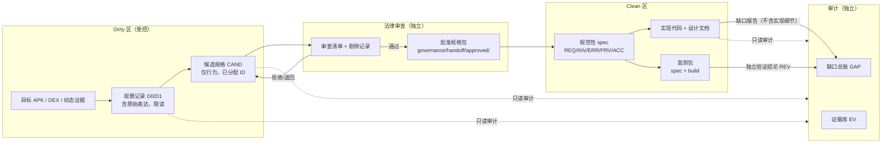

# 信息流与污染控制

## 1. 铁律

1. 信息只能沿 **分析组 → 候选规格 → 法律审查 → 批准规格 → 实现组** 单向流动。
2. 分析组与实现组之间**禁止直接交流**；不存在“技术咨询”“顺手问一句”的例外。
3. 规格书在法律审查前不得进入实现组；审查必须剔除代码片段、独特界面设计、具体变量/函数/类/资源命名、原始布局与字符串。
4. 实现组不得向分析组提供任何实现信息（包括测试结果、性能数字、模块命名、缺陷清单）。
5. 验证评审者不得是该子系统作者，且不得阅读对应实现文档或源码。

---

## 2. 信息流图

**图中不存在的边**：Dirty → Clean、Clean → Dirty、Clean → 候选规格、Dirty → 验收结果。

---

## 3. 通道定义

| 通道 | 方向 | 内容 | 载体 | 访问控制 |
|---|---|---|---|---|
| CH-1 观察 | 目标 → Dirty | APK、反编译、抓包、截图、日志 | Dirty 工作区 `apk/ dex/ reports/ frida/` | 仅 DIRTY + AUDIT |
| CH-2 候选规格 | Dirty → COUNSEL | 行为条款、ID、验证方法；**无**代码/命名/布局 | `governance/handoff/candidate/`（或 Dirty `specs/` 的 `CAND` 文件） | DIRTY 写，COUNSEL/AUDIT 读 |
| CH-3 审查记录 | COUNSEL → AUDIT/OWNER | 逐条接受/剔除/理由 | `governance/reviews/LEG-*.md` | COUNSEL 写，AUDIT/OWNER 读 |
| CH-4 批准规格 | COUNSEL → CLEAN | 清洗后的规格 + 条款 ID + 验收映射 | `governance/handoff/approved/`（只读） | COUNSEL 写，CLEAN/AUDIT 读 |
| CH-5 缺口 | CLEAN/AUDIT → 总账 | 规格与实现不一致；只写条款 ID 与行为差异 | `governance/gaps/GAP-REGISTER.md` | CLEAN 写，AUDIT 审 |
| CH-6 验证 | REVIEW → AUDIT | 按 ACC ID 的 PASS/FAIL、环境、证据 | `governance/reviews/REV-*.md` | REVIEW 写，AUDIT 读 |

---

## 4. 候选规格的“可交付”判定

候选规格只有在同时满足以下条件时才可交给法律审查：

- [ ] 每条需求/不变量/错误/验收都有稳定 ID；
- [ ] 不包含源代码、伪代码、反编译类名、方法名、字段名、资源 ID、布局文件名；
- [ ] 不包含原始产品的独特界面构图、配色值、图标、文案逐字复刻；
- [ ] 不引用 Clean 仓库的任何路径、文件名、模块名、测试结果；
- [ ] 规定性条款与解释性说明分文件存放；
- [ ] 每条条款有可执行的验证方法或指向 `ACC-*`；
- [ ] 文档头有 `CLASSIFICATION`、`LEGAL-STATUS`、`OWNER`、`BASELINE` 元数据。

未满足任一项：不得投递 `approved/`。

---

## 5. 法律审查后的清洗规则

审查员逐条处理，并在 `LEG-*.md` 留痕：

| 类别 | 处理 |
|---|---|
| 代码片段 / 伪代码 | 删除；改写为行为描述与输入输出 |
| 类名/方法名/字段名/资源名 | 删除；用角色名（“下载任务”“分片”）替代 |
| 原始布局/控件树/尺寸链 | 删除；只保留可观察的用户目标，不保留实现结构 |
| 独特视觉设计（配色、图标、动效曲线） | 删除或改为独立设计约束；登记为 `GAP`/设计决策 |
| 原始文案 | 删除逐字文案；用含义描述 |
| 通用事实（协议、文件扩展名、HTTP 语义） | 可保留，但需说明来源与选择理由 |
| 商标/产品名 | 仅用于互操作性说明；不得作为实现命名或界面品牌 |

审查结论只有三种：`APPROVED`、`APPROVED-WITH-REDACTIONS`、`REJECTED`。任一 `REJECTED` 条款不得进入 `approved/`。

---

## 6. 污染事件处置

1. **发现**：任何人发现反向引用、实现状态泄漏、原始表达进入规格，立即登记 `INC-*`。
2. **遏制**：停止相关门禁；把受影响文档移入隔离区（`specs/_quarantine/` 或 Dirty 侧），加 `DO-NOT-READ` 标记。
3. **范围评估**：确定哪些 `REQ-*`/代码模块可能受影响；不能证明独立性的，标 `BLOCKED`。
4. **纠正**：删除反向内容；必要时由 COUNSEL 重新审查或由 CLEAN 独立重设计。
5. **验证**：`governance_check.py` 通过 + AUDIT 签署；未关闭前不得发布。
6. **记录**：事件、根因、影响、措施写入审计报告与缺口总账。

---

## 7. 物理与账号隔离（补偿控制）

同一 Windows 账户下无法靠目录权限证明隔离时，至少执行：

- Dirty 工作区与 Clean 工作区不互相挂载到对方工具链；
- Clean 构建机不安装目标 APK，不使用装有目标的 AVD；
- 测试设备/AVD 命名不得复用 Dirty 环境名；
- 所有跨区文件移动由 AUDIT 执行并记录哈希；
- `governance_check.py` 每次门禁前运行，结果归档 `EV-*`。

> 这些是补偿控制，不替代真正的账号/主机隔离。若监管或诉讼场景要求更强证明，应使用独立主机与独立账户。
